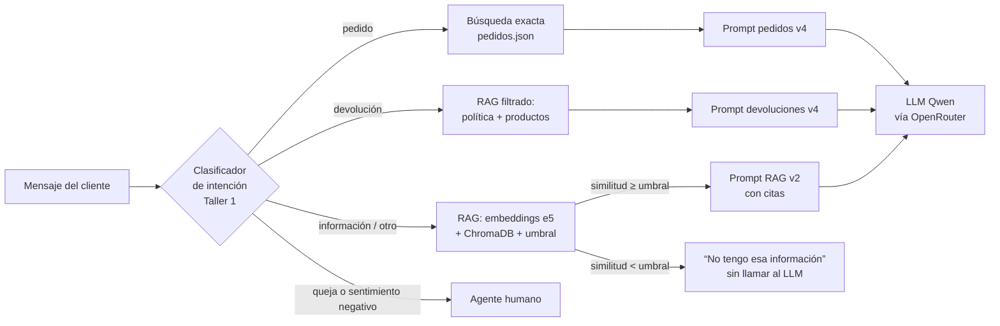

# EcoMarket: atención al cliente con RAG

**Taller Práctico #2 — IA Generativa**
Maestría en Inteligencia Artificial Aplicada

**Estudiante: Pedro Albeiro Jojoa Hernández**

Continuación del [Taller Práctico #1](https://github.com/peteralbeiro09-hub/Taller-pr-ctico-1---G1-).

## El caso en tres líneas

En el Taller 1 el asistente de EcoMarket respondía dos tipos de consulta (pedidos y devoluciones) pegando documentos completos en el prompt, y escalaba todo lo demás a un humano. En este taller se le agrega un sistema **RAG (Generación Aumentada por Recuperación)**: antes de responder, el asistente busca en una base de conocimiento vectorial los fragmentos relevantes de los documentos de la empresa. Así puede responder **cualquier** consulta que esos documentos cubran y, cuando no encuentra evidencia, **dice que no tiene la información** en lugar de inventarla.

## Índice de las fases

| Fase | Documento | Contenido |
|---|---|---|
| 1. Selección de componentes | [docs/fase1_componentes.md](docs/fase1_componentes.md) | Modelo de embeddings y base de datos vectorial: alternativas, costo, español, privacidad, escalabilidad y criterio de migración |
| 2. Base de conocimiento | [docs/fase2_base_conocimiento.md](docs/fase2_base_conocimiento.md) · [data/](data/) | 4 tipos de documento, estrategia de *chunking* comparada con datos, proceso de indexación |
| 3. Integración y código | [docs/fase3_integracion.md](docs/fase3_integracion.md) · [src/](src/) · [results/](results/) | Explicación del código por sección, cambios sobre el Taller 1, experimentos, limitaciones y suposiciones |

## Arquitectura



| Componente | Elección | Dónde |
|---|---|---|
| Framework | LangChain (loaders, splitters, `HuggingFaceEmbeddings`, `Chroma`, LCEL) | `src/ingesta.py`, `src/indice.py`, `src/rag.py` |
| Embeddings | `intfloat/multilingual-e5-small` (abierto, local, español) | `src/indice.py` |
| Base vectorial | ChromaDB embebida y persistente, similitud coseno | `chroma_db/` (se genera) |
| LLM | El mismo del Taller 1: Qwen gratis vía OpenRouter (o Ollama/Groq/OpenAI desde `.env`) | `src/llm.py` |

## Ejecución

Requisito: Python 3.11 o superior (probado con 3.13).

```bash
# 1. Clonar el repositorio
git clone https://github.com/peteralbeiro09-hub/Taller-practico-2.git
cd Taller-practico-2

# 2. Crear y activar un entorno virtual
python -m venv .venv
.venv\Scripts\activate          # Windows
# source .venv/bin/activate     # macOS / Linux

# 3. Instalar las dependencias (incluye PyTorch para los embeddings; la descarga es grande)
pip install -r requirements.txt

# 4. Construir la base de conocimiento vectorial (la primera vez descarga el modelo de embeddings, ~470 MB)
python app.py indexar

# 5. Probar la recuperación, sin LLM y sin clave
python app.py buscar "¿cuánto cuesta el envío a Pasto?"

# 6. Configurar el LLM (igual que en el Taller 1) y conversar
copy .env.example .env          # Windows  (cp .env.example .env en macOS / Linux) y completar LLM_API_KEY
python app.py chat
```

Los pasos 1 a 5 funcionan **sin clave ni conexión al LLM**. Para la clave gratuita de OpenRouter, ver la sección “Cómo obtener la clave” del [README del Taller 1](https://github.com/peteralbeiro09-hub/Taller-pr-ctico-1---G1-#modelo-usado-qwen-alibaba-gratis-v%C3%ADa-openrouter).

### Comandos

```bash
python app.py indexar [--estrategia estructura|parrafos|fijo]     # Fase 2: carga → chunking → embeddings → Chroma
python app.py fragmentos --fuente faq.json                        # Ver los chunks generados (sin embeddings)
python app.py buscar "<texto>" --k 5                              # Solo recuperación, con similitud y umbral
python app.py preguntar "<texto>"                                 # RAG v2 (estricto, con citas y umbral)
python app.py preguntar "<texto>" --version v1 --umbral 0         # RAG v1 (sin reglas ni umbral)
python app.py preguntar "<texto>" --sin-rag                       # Línea base: el LLM sin base de conocimiento
python app.py preguntar "<texto>" --mostrar-prompt                # Ver el prompt armado, sin llamar al LLM
python app.py chat                                                # Cadena completa: Taller 1 + RAG
python app.py experimento-recuperacion                            # Compara estrategias de chunking y calibra el umbral (sin LLM)
python app.py evaluar [--solo rag|cadena] [--parcial]             # Ejecuta los casos de prueba con el LLM y escribe results/
```

## Estructura del repositorio

```
├── README.md
├── docs/
│   ├── fase1_componentes.md          Fase 1: embeddings y base vectorial
│   ├── fase2_base_conocimiento.md    Fase 2: documentos, chunking, indexación
│   └── fase3_integracion.md          Fase 3: código, experimentos, limitaciones y suposiciones
├── data/                             Base de conocimiento (datos ficticios)
│   ├── politica_devoluciones.pdf     PDF   → se indexa por secciones
│   ├── politica_envios.md            Markdown → se indexa por secciones
│   ├── faq.json                      JSON  → una pregunta por fragmento
│   ├── inventario.csv                CSV   → un producto por fragmento
│   ├── pedidos.json                  NO se indexa: búsqueda exacta por número (datos personales)
│   ├── casos_prueba.json             Casos del Taller 1 + preguntas RAG + fuera de dominio
│   └── fuentes/politica_devoluciones.md   Fuente editable desde la que se genera el PDF
├── prompts/
│   ├── rag.toml                      Línea base sin RAG, RAG v1 y RAG v2
│   ├── cadena.toml                   Clasificador (nueva intención "informacion") y escalamiento
│   ├── pedidos.toml, devoluciones.toml   Prompts v4 del Taller 1
├── src/
│   ├── ingesta.py                    Loaders por tipo de documento + 3 estrategias de chunking
│   ├── indice.py                     Embeddings E5 (prefijos query/passage) + ChromaDB
│   ├── rag.py                        Recuperación con umbral + cadena LCEL
│   ├── cadena.py                     Cadena del Taller 1 con RAG integrado
│   ├── llm.py, config.py, prompts.py, contexto.py   Base del Taller 1 (con ajustes)
├── scripts/generar_pdf_politica.py   Genera el PDF de la política
├── app.py                            CLI
├── results/                          Evidencia: experimentos y respuestas reales
├── requirements.txt
└── .env.example
```

Todos los datos (clientes, pedidos, precios, políticas, transportadoras y URL) son **ficticios** y se crearon para este taller.
