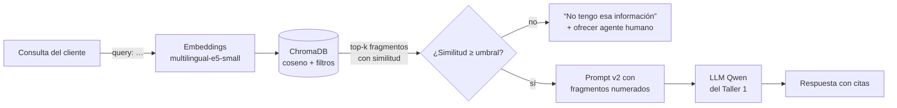

# Fase 1 — Selección de los componentes clave del sistema RAG

## 1. Qué tiene que resolver el RAG en EcoMarket

En el Taller 1 el asistente respondía bien dos tipos de consulta (pedidos y devoluciones). Lo lograba **pegando documentos completos** en el prompt: la política, el catálogo y los 15 pedidos. Así quedaron tres problemas:

| Problema del Taller 1 | Consecuencia | Qué exige del RAG |
|---|---|---|
| Todo lo que no fuera pedido o devolución se escalaba a un humano | Preguntas simples ("¿aceptan Nequi?", "¿cuánto cuesta el envío a Pasto?") llegaban al equipo humano | Responder **cualquier** consulta cubierta por los documentos de la empresa |
| Sin documentos, el modelo **inventó** la política de devoluciones (v1 del Taller 1) | Alucinaciones con impacto económico y legal | Basar la respuesta en fragmentos recuperados y **decir "no sé"** cuando no haya evidencia |
| El contexto crece con cada documento nuevo (~1.800 tokens de entrada por consulta, Fase 1 del Taller 1) | Más costo y más ruido a medida que crece la base | Pasar al modelo **solo los fragmentos relevantes** |

Supuestos de volumen del Taller 1: **5.000 consultas diarias**, 70 % automatizables, es decir **≈105.000 consultas al mes**. Además, todas las consultas son **en español colombiano** y muchas son informales: "¿en qué va mi pedido?", "¿me devuelven la plata?".

Con esto, los criterios para elegir los componentes son, en orden de peso:

1. **Calidad de recuperación en español**, incluido el lenguaje coloquial frente al texto formal de las políticas.
2. **Privacidad (Ley 1581 de 2012):** preferir que los documentos y las consultas no salgan de la infraestructura propia.
3. **Costo** a 105.000 consultas al mes.
4. **Escalabilidad y facilidad de operación** para un equipo pequeño.

## 2. Modelo de embeddings

### 2.1 Alternativas evaluadas

| Modelo | Tipo | Dimensión | Contexto máx. | Tamaño | Español | Costo a 105 k consultas/mes* | Privacidad |
|---|---|---|---|---|---|---|---|
| **`intfloat/multilingual-e5-small`** ✅ | Abierto (MIT), Hugging Face | 384 | 512 tokens | ~470 MB | Bueno: entrenado con pares multilingües, incluido español | **USD 0** (CPU propia) | Los datos no salen del servidor |
| `paraphrase-multilingual-MiniLM-L12-v2` | Abierto (Apache 2.0) | 384 | **128 tokens** | ~470 MB | Aceptable; pensado para frases cortas | USD 0 | Local |
| `intfloat/multilingual-e5-base` / `-large` | Abierto (MIT) | 768 / 1024 | 512 tokens | ~1,1 / 2,2 GB | Mejor que *small* | USD 0, pero más CPU/GPU | Local |
| `BAAI/bge-m3` | Abierto (MIT) | 1024 | 8.192 tokens | ~2,2 GB | Muy bueno; recuperación densa + léxica | USD 0, pero en CPU es lento | Local |
| OpenAI `text-embedding-3-small` | Propietario (API) | 1536 | 8.191 tokens | — | Muy bueno | ≈ USD 0,06 / mes [VERIFICAR] | Los textos viajan a un tercero |
| Cohere `embed-multilingual-v3.0` | Propietario (API) | 1024 | 512 tokens | — | Muy bueno; diseñado para multilingüe | ≈ USD 0,3 / mes [VERIFICAR] | Los textos viajan a un tercero |

\* Costo de vectorizar las **consultas**: 105.000 × ~30 tokens ≈ 3,2 M tokens/mes. Indexar la base de conocimiento (decenas de fragmentos, < 20 k tokens) cuesta centavos una sola vez. Los precios de las API son de lista: USD 0,02 y 0,10 por millón de tokens [VERIFICAR en https://openai.com/api/pricing y https://cohere.com/pricing].

### 2.2 Decisión: `intfloat/multilingual-e5-small`

**Por qué este modelo:**

- **Español:** la familia E5 multilingüe está entre los modelos abiertos mejor ubicados en tareas de recuperación del benchmark MTEB para idiomas distintos del inglés, y su versión *small* conserva buena parte de esa calidad. En nuestras pruebas, consultas coloquiales como "¿me devuelven la plata?" recuperan la sección de reembolsos de la política. La evidencia está en [`results/experimento_recuperacion.md`](../results/experimento_recuperacion.md).
- **Costo:** se ejecuta en CPU, sin GPU ni pago por token. Una consulta se vectoriza en milisegundos, despreciable frente a la latencia del LLM, que es de segundos.
- **Privacidad:** las consultas de los clientes pueden incluir nombres, direcciones o detalles de salud (por ejemplo, la copa menstrual). Con un modelo local nunca salen del servidor, lo que simplifica cumplir la Ley 1581, analizada en la Fase 2 del Taller 1.
- **Contexto de 512 tokens:** basta para nuestros fragmentos (~600 caracteres ≈ 150 tokens). En cambio, MiniLM se queda en 128 tokens y truncaría secciones de la política.
- **Código abierto:** es coherente con la decisión del Taller 1 de usar un LLM de pesos abiertos (Qwen) y evita depender de un solo proveedor.

**Detalle técnico que importa:** los modelos E5 se entrenaron con el prefijo `query:` en las preguntas y `passage:` en los documentos. Sin los prefijos la recuperación empeora. Por eso `src/indice.py` envuelve el modelo en la clase `EmbeddingsE5`, que los agrega automáticamente. Además, los vectores se **normalizan**, de modo que la similitud coseno de ChromaDB queda entre 0 y 1 y se puede fijar un **umbral** para decir "no sé".

**Desventajas aceptadas y ruta de migración:**

- Ante sinónimos raros o consultas muy largas es algo menos preciso que `bge-m3` o los modelos de pago.
- El modelo se fija en una variable (`RAG_MODELO_EMBEDDINGS` en `.env`). Cambiarlo solo exige **reindexar** (`python app.py indexar`), porque los vectores de modelos distintos no son comparables.
- Si la base crece a miles de documentos con preguntas más difíciles, el siguiente paso es `multilingual-e5-base` o `bge-m3` con GPU. Si la empresa acepta enviar datos a un tercero con un acuerdo de tratamiento, la alternativa es `text-embedding-3-small`.

## 3. Base de datos vectorial

### 3.1 Alternativas evaluadas

| Criterio | **ChromaDB** ✅ | Pinecone | Weaviate |
|---|---|---|---|
| Modelo de despliegue | Embebida en el proceso de Python (persistencia en disco) o servidor cliente/servidor; también existe Chroma Cloud | Solo servicio gestionado (SaaS, *serverless*) | Código abierto autoalojado (Docker/Kubernetes) o Weaviate Cloud |
| Costo para EcoMarket | **USD 0** (Apache 2.0, corre en el mismo servidor) | Plan gratuito limitado; los planes de producción tienen un mínimo mensual [VERIFICAR en https://www.pinecone.io/pricing] | USD 0 autoalojado (más el costo del servidor); la nube es de pago |
| Facilidad de uso | `pip install chromadb`, sin servidor; integración nativa con LangChain (`langchain-chroma`) | Muy fácil: API y consola web, cero operación | Más curva: esquema de clases, módulos y operar el clúster |
| Escalabilidad | Buena hasta millones de vectores en un nodo; no distribuye de forma nativa | Muy alta (miles de millones), réplicas y escalado automático | Alta: *sharding*, replicación y multi-tenant |
| Búsqueda híbrida (vector + palabra clave) | Filtros por metadatos; sin BM25 nativo | Sí (vectores *sparse-dense*) | **Sí, nativa (BM25 + vector)** |
| Privacidad | Los datos quedan en el servidor propio | Los datos residen en la nube del proveedor | Propia si se autoaloja |
| Riesgo principal | Un solo nodo: alta disponibilidad y concurrencia limitadas | Costo recurrente y dependencia del proveedor | Carga operativa para un equipo pequeño |

### 3.2 Decisión: ChromaDB (embebida y persistente)

**Por qué ChromaDB para EcoMarket hoy:**

- **El tamaño real del problema es pequeño.** La base de conocimiento son cuatro documentos y decenas de fragmentos; aunque crezca a todo el catálogo y a cientos de preguntas frecuentes, serán miles de vectores, no millones. A esa escala la búsqueda exacta o HNSW en un solo nodo tarda milisegundos. Pagar Pinecone u operar un clúster de Weaviate sería sobredimensionar.
- **Costo cero y misma infraestructura.** Se instala como librería y guarda el índice en `chroma_db/`, junto al orquestador del Taller 1. No hay servicio adicional que pagar ni administrar.
- **Filtros por metadatos.** Cada fragmento lleva `fuente`, `tipo`, `seccion` y `categoria`. La cadena los usa: para devoluciones solo busca en la política y en los productos (`filter={"fuente": "politica_devoluciones.pdf"}`).
- **Privacidad:** los documentos internos no salen del servidor, igual que con el modelo de embeddings local.
- **Integración con LangChain** directa (`Chroma`, `similarity_search_with_relevance_scores`) y similitud coseno configurable (`hnsw:space = cosine`).

**Cuándo migrar** (criterio explícito):

| Señal | Migrar a | Motivo |
|---|---|---|
| Varias instancias del orquestador comparten el índice (alta disponibilidad) | Chroma en modo servidor o Weaviate | Una base embebida no se comparte bien entre procesos |
| Más de ~1 M de vectores o requisitos multi-región | Pinecone o Weaviate en clúster | Escalado horizontal y réplicas gestionadas |
| Muchas consultas con códigos exactos (SKU, referencias) que el vector no distingue | Weaviate (híbrido BM25 + vector) | La búsqueda léxica complementa a la semántica |

Gracias a la abstracción `VectorStore` de LangChain, la migración cambia la construcción del índice en `src/indice.py`, no la cadena.

## 4. Cómo cada componente impacta la eficacia del RAG

- **El modelo de embeddings decide el *recall*.** Si "¿me devuelven la plata?" no queda cerca de "Reembolso al medio de pago original", el fragmento correcto nunca llega al LLM, y ningún prompt lo compensa. Por eso pesa tanto la calidad en español.
- **La base vectorial decide la latencia, los filtros y la escalabilidad.** Además, su puntaje de similitud permite fijar el **umbral** que separa "sé la respuesta" de "no sé", que es la pieza clave para responder ante **cualquier** solicitud sin alucinar.
- **El LLM ya no necesita "saber" de EcoMarket.** Solo debe leer y redactar a partir del contexto. Eso permite seguir usando un modelo abierto y barato como Qwen (Taller 1) y actualizar la información **reindexando**, sin reentrenar nada.
