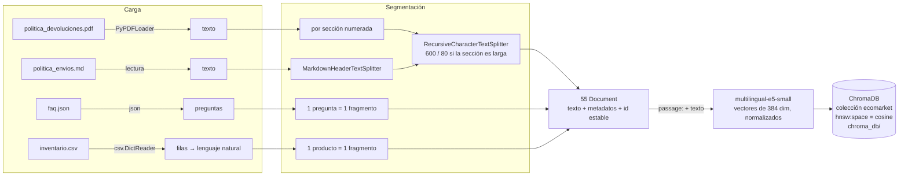

# Fase 2 — Creación de la base de conocimiento

## 1. Identificación de documentos

Se eligieron los documentos que responden las preguntas más frecuentes de atención al cliente: el 80 % repetitivo del caso, según el Taller 1. Cada uno tiene un **formato distinto**, como pasa en una empresa real, y por eso necesita un *loader* y una estrategia de segmentación propios.

| # | Documento | Formato | Qué responde | Ejemplo de consulta | Dueño (quién lo mantiene) |
|---|---|---|---|---|---|
| 1 | [`politica_devoluciones.pdf`](../data/politica_devoluciones.pdf) | **PDF** (7 secciones) | Plazos, condiciones, productos no devolvibles, excepción por daño, proceso, reembolso y costos | "¿En cuánto tiempo me reembolsan?" | Área legal |
| 2 | [`politica_envios.md`](../data/politica_envios.md) | **Markdown** (8 secciones, incluida una tabla) | Cobertura, tiempos y costos por zona, empaque, rastreo, retrasos, cambio de dirección, entrega fallida | "¿Cuánto cuesta el envío a Pasto?" | Logística |
| 3 | [`faq.json`](../data/faq.json) | **JSON** (24 preguntas) | Pagos, cuenta, EcoPuntos, garantías, sostenibilidad, horarios, tarjetas de regalo | "¿Puedo pagar con Nequi?" | Servicio al cliente |
| 4 | [`inventario.csv`](../data/inventario.csv) | **CSV** (15 productos) | Precio, stock, si es devolvible, materiales, descripción y cuidado de cada producto | "¿La botella va al lavavajillas?" | Comercial / bodega |

Los documentos 1 y 4 amplían los del Taller 1: la política, antes en Markdown, ahora es un PDF, y el catálogo de 4 columnas pasó a un inventario con stock, materiales y cuidados. Los documentos 2 y 3 son nuevos. Todos los datos son **ficticios**.

### ¿Qué NO se indexa y por qué?

**`pedidos.json` no entra a la base vectorial.** Se consulta por **búsqueda exacta** del número `ECO-XXXXX` (`src/contexto.py`), igual que haría una herramienta (*tool calling*) contra la base de datos de pedidos. Hay tres razones:

1. **La similitud semántica no sirve para identificadores.** Para un modelo de embeddings, `ECO-10005` y `ECO-10008` son casi idénticos. Un RAG podría devolverle a un cliente el pedido de otro.
2. **Privacidad (Ley 1581):** los pedidos tienen nombres de clientes. Con la búsqueda exacta, el modelo solo ve el pedido que el cliente mencionó. En el Taller 1 veía los 15 pedidos en cada consulta.
3. **Frescura:** el estado de un pedido cambia varias veces al día. Reindexarlo en la base vectorial cada vez sería costoso e innecesario.

**La regla general:** el RAG sirve para conocimiento **no estructurado y estable**, como políticas, preguntas frecuentes y fichas de producto. Los datos **transaccionales** se consultan con herramientas.

## 2. La calidad del documento importa antes que el chunking

Al preparar los documentos se tomaron decisiones de calidad que afectan directamente la recuperación:

- **Una sola versión de la verdad.** El catálogo del Taller 1 y el inventario no se mantienen en paralelo: el inventario lo reemplaza. Si dos documentos dicen cosas distintas sobre el mismo producto, el RAG recupera ambos y el LLM tiene que adivinar.
- **Filas de CSV convertidas a lenguaje natural.** Una fila como `ECO-P001,Botella...,Hogar,65000,42,si,...` se transforma en "Producto: Botella... Precio: $65.000 COP. Disponibilidad: disponible (42 unidades)...". Hay dos motivos:
  - El modelo de embeddings se entrenó con texto, no con valores separados por comas.
  - Los valores crudos son ambiguos: `0` no dice "agotado" y `si` no dice "admite devolución".
- **Explicitar lo que el cliente pregunta.** Ese mismo paso escribe "AGOTADO" cuando el stock es 0 y "NO admite devolución (salvo defecto o daño)". Así, "¿tienen pitillos disponibles?" encuentra la respuesta en el texto en lugar de depender de que el LLM interprete un número.
- **Títulos de sección consistentes y numerados** en las políticas. De ellos depende la segmentación por estructura. El PDF pierde el formato de Markdown al extraer el texto, pero conserva "4. Excepción: producto dañado o defectuoso".

## 3. Segmentación (chunking)

### 3.1 Estrategias consideradas

| Estrategia | Cómo funciona | Ventaja | Problema para EcoMarket |
|---|---|---|---|
| **Tamaño fijo** | Corta cada N caracteres (`CharacterTextSplitter(separator="")`) | Simple y predecible | Parte reglas por la mitad y mezcla productos |
| **Por párrafos** | Corta en cada línea en blanco y junta párrafos hasta N caracteres | Respeta párrafos | Si caben, junta **varios productos o preguntas** en un fragmento |
| **Recursiva** | Intenta cortar por párrafo, luego por línea, luego por oración (`RecursiveCharacterTextSplitter`) | No corta oraciones si puede evitarlo | Aplicada a ciegas, no conoce las secciones ni las unidades del documento |
| **Por estructura** ✅ (propuesta) | Usa la unidad natural de cada formato: sección en las políticas, pregunta en el FAQ, fila en el inventario. Solo recurre a la división recursiva si una sección supera 600 caracteres | Cada fragmento es **una idea completa** con metadatos | Requiere un *loader* por tipo de documento |

### 3.2 La propuesta: segmentación por estructura del documento

Implementada en [`src/ingesta.py`](../src/ingesta.py):

| Documento | Unidad de fragmento | Herramienta | Fragmentos |
|---|---|---|---|
| Política de devoluciones (PDF) | Una sección numerada ("4. Excepción…"); los pasos numerados de la sección 5 no se confunden con títulos | `PyPDFLoader` + detección de títulos consecutivos + `RecursiveCharacterTextSplitter` (600/80) | 7 |
| Política de envíos (MD) | Una sección `##` | `MarkdownHeaderTextSplitter` + `RecursiveCharacterTextSplitter` (600/80) | 9 (la sección 2, con la tabla de zonas, se divide en 2) |
| FAQ (JSON) | Un par pregunta-respuesta, **nunca se parte** | Un `Document` por elemento | 24 |
| Inventario (CSV) | Un producto | Un `Document` por fila | 15 |
| **Total** | | | **55** |

**Por qué esta estrategia es la mejor para este caso:**

- **La unidad de respuesta coincide con la unidad del documento.** Las preguntas de los clientes casi siempre se responden con *una* regla, *una* pregunta frecuente o *un* producto. Si el fragmento es exactamente eso, el LLM recibe la respuesta completa y nada más.
- **No mezcla productos.** Es el riesgo más grave para EcoMarket. Si un fragmento tiene la botella (devolvible) y el café (no devolvible), el LLM puede atribuir al café la condición de la botella. Con la estrategia por estructura, **0 fragmentos** mezclan productos o preguntas; con párrafos son 10 y con tamaño fijo, 15 (tabla de §4).
- **No corta reglas por la mitad.** Con tamaño fijo, la excepción por daño queda partida: "Adjunte al menos una foto en la que…" en un fragmento y "…se vea el daño o defecto" en el siguiente. El fragmento recuperado puede tener el plazo de 48 horas sin la condición de la foto, o al revés. Se puede verificar con `python app.py fragmentos --estrategia fijo`.
- **Metadatos útiles.** Cada fragmento lleva `fuente`, `tipo`, `seccion` y, en productos, `sku`, `categoria` y `devolvible`. Sirven para tres cosas:
  1. **Citar la fuente:** el prompt v2 numera los fragmentos y el modelo cita [1], [2].
  2. **Filtrar:** el flujo de devoluciones busca solo en la política de devoluciones y en los productos.
  3. **Auditar:** se puede ver de qué sección salió cada respuesta.
- **Tamaño 600 / solape 80.** Ninguna sección de las políticas supera ~900 caracteres. Con 600, casi todas quedan en un fragmento (~150 tokens, muy por debajo de los 512 del modelo E5), y el solape de 80 caracteres conserva el contexto cuando una sección larga se divide. Los dos valores se pueden cambiar en `.env` (`RAG_CHUNK_TAMANO`, `RAG_CHUNK_SOLAPE`).

## 4. Evidencia: comparación medida de las estrategias

`python app.py experimento-recuperacion` indexa la base con las tres estrategias y mide, **sin llamar al LLM**, en qué posición aparece el fragmento que contiene la evidencia de cada una de las 12 preguntas de prueba. El resultado completo está en [`results/experimento_recuperacion.md`](../results/experimento_recuperacion.md):

| Estrategia | Fragmentos | Largo medio | Mezclan varios productos o preguntas | Acierto@1 | Acierto@3 | MRR |
|---|---|---|---|---|---|---|
| **Por estructura** ✅ | 55 | 329 | **0** | 75 % | **100 %** | 0,86 |
| Por párrafos | 36 | 516 | 10 | 92 % | 100 % | 0,96 |
| Tamaño fijo | 34 | 548 | 15 | 42 % | 75 % | 0,61 |

**Lectura honesta de los resultados:**

- **El tamaño fijo es claramente el peor.** Solo en 5 de 12 preguntas el fragmento correcto queda primero, y en 3 ni siquiera entra en los 3 primeros.
- **Por párrafos gana en acierto@1, por una razón que no es mérito propio:** sus fragmentos son 57 % más largos y juntan varias preguntas o productos. Un fragmento más grande tiene más probabilidad de "contener" la evidencia. El costo es que **10 fragmentos mezclan unidades**, justo el riesgo de atribución cruzada que describimos arriba, y que el LLM recibe más texto irrelevante.
- **Con k = 4, que es lo que usa el sistema, la estrategia por estructura recupera el fragmento correcto en el 100 % de los casos**, con fragmentos limpios. Eso es lo que importa, porque el LLM recibe los 4 primeros y no solo el primero. Por eso se mantiene como propuesta.

**Una iteración que el experimento obligó a hacer.** En la primera versión, cada fragmento de las políticas empezaba con un encabezado contextual: "Política de envíos de EcoMarket — 3. Costo del envío". La idea parecía buena, pero el experimento mostró lo contrario:

| Variante (estructura, 600) | Acierto@1 | Acierto@3 | Posición de "¿Hacen envíos a México?" |
|---|---|---|---|
| Con el título del documento en el texto | 75 % | 92 % | 5 (queda **fuera** de k = 4) |
| Sin el título en el texto (versión final) | 75 % | **100 %** | 3 |

El título repetido hace que **todos** los fragmentos de un documento se parezcan entre sí, y así se diluye lo que distingue a cada sección. Ahora el título y la sección viven en los **metadatos**, y el LLM los sigue viendo porque `formatear_contexto()` antepone "fuente › sección" a cada fragmento.

**Limitación del experimento:** son 12 preguntas, así que una diferencia de un caso equivale a 8 puntos porcentuales. Sirve para descartar estrategias malas (tamaño fijo) y detectar problemas concretos (el encabezado), no para afinar decimales.

## 5. Indexación

Paso a paso (`python app.py indexar`, que llama a `src/ingesta.py` y `src/indice.py`):

1. **Carga:** cada *loader* convierte su formato en texto. El PDF se lee con `PyPDFLoader` y sus páginas se unen para que una sección no se corte entre páginas.
2. **Limpieza y normalización:** las filas del CSV pasan a párrafos, el stock 0 se escribe como "AGOTADO" y los títulos se detectan.
3. **Segmentación** por estructura (§3), con metadatos.
4. **Ids estables** (`politica_envios.md::004`). `construir_indice()` vacía la colección y vuelve a cargarla, así que **reindexar no duplica** fragmentos. Esto importa porque, cuando cambie una política, basta con volver a ejecutar el comando.
5. **Vectorización:** `EmbeddingsE5` antepone `passage: ` a cada fragmento, calcula su vector de 384 dimensiones con `multilingual-e5-small` y lo normaliza.
6. **Carga en ChromaDB:** `add_documents` guarda vector, texto y metadatos en una colección con distancia coseno, persistida en `chroma_db/`.
7. **Consulta (en tiempo de respuesta):** la pregunta se vectoriza con el prefijo `query: ` y Chroma devuelve los k fragmentos más cercanos con su similitud. Lo que pasa después está en la [Fase 3](fase3_integracion.md).

La indexación completa tarda unos segundos en CPU. La primera vez además descarga el modelo, de ~470 MB.
