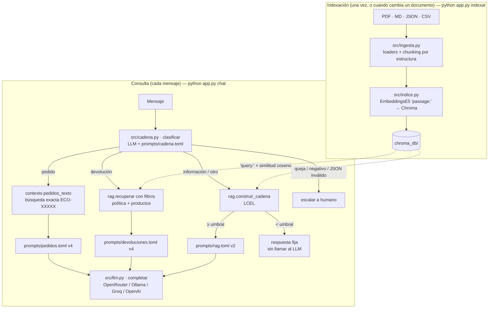

# Fase 3 — Integración y ejecución del código

## 1. Cómo se conectan las piezas

El sistema parte del asistente del Taller 1, que clasifica → enruta → responde o escala, y le agrega un RAG construido con **LangChain**. El LLM y su cliente (`src/llm.py`) son los mismos del Taller 1, de modo que caché, reintentos y proveedor configurable por `.env` siguen funcionando.



Las tres piezas que pide la rúbrica son:

- **El modelo de embeddings** (`EmbeddingsE5` en `src/indice.py`) se usa **dos veces**: en la indexación vectoriza los fragmentos (`passage:`) y en cada consulta vectoriza la pregunta (`query:`). Las dos llamadas deben usar el mismo modelo; si se cambia, hay que reindexar.
- **La base vectorial** (`Chroma` en `src/indice.py`) guarda los vectores con sus metadatos. Ante una consulta devuelve los k fragmentos más cercanos **con su similitud**, que es el número que permite decidir si hay evidencia suficiente para responder.
- **El chaining** (`src/rag.py`, LCEL) encadena *recuperar → decidir (umbral) → armar prompt → LLM*. A su vez, `src/cadena.py` decide **cuándo** usar el RAG y cuándo otro camino.

## 2. Recorrido del código por sección

### 2.1 `src/config.py`: parámetros
Además de lo del Taller 1 (rutas, `.env`, fecha de referencia, temperatura 0), centraliza los parámetros del RAG:

| Parámetro | Valor | Efecto |
|---|---|---|
| `MODELO_EMBEDDINGS` | `intfloat/multilingual-e5-small` | Calidad de la recuperación en español (Fase 1) |
| `RAG_K` | 4 | Cuántos fragmentos recibe el LLM: más contexto, pero también más ruido y más tokens |
| `RAG_UMBRAL` | 0,80 | Similitud mínima para considerar que hay evidencia; por debajo, "no tengo información" |
| `CHUNK_TAMANO` / `CHUNK_SOLAPE` | 600 / 80 | Tamaño de la división recursiva de secciones largas (Fase 2) |

Todos se pueden cambiar en `.env` sin tocar código. Así se reproducen los experimentos de §5.

### 2.2 `src/ingesta.py`: de archivos a fragmentos
- `_texto_pdf()` usa `PyPDFLoader` (LangChain Community) y une las páginas.
- `_chunks_politica_pdf()` detecta los títulos "N. Título" exigiendo **número consecutivo, línea corta y sin punto final**. Sin esa regla, los pasos "1. Escribir a atención al cliente…" de la sección 5 se tomaban como secciones nuevas.
- `_chunks_envios_md()` usa `MarkdownHeaderTextSplitter`, que guarda el título `##` en los metadatos.
- `_chunks_faq()` y `_chunks_inventario()` generan un `Document` por pregunta y por producto. `_texto_producto()` convierte la fila del CSV en lenguaje natural (Fase 2 §2).
- `_secciones()` aplica `RecursiveCharacterTextSplitter` solo cuando una sección supera el tamaño máximo.
- `fragmentar(estrategia)` es el punto de entrada. También implementa las estrategias `parrafos` y `fijo` para poder compararlas, y asigna ids estables (`fuente::NNN`).

### 2.3 `src/indice.py`: embeddings y ChromaDB
- `EmbeddingsE5` implementa la interfaz `Embeddings` de LangChain y envuelve `HuggingFaceEmbeddings` para agregar los prefijos `query:`/`passage:` y normalizar los vectores.
- `construir_indice()` abre la colección con `collection_metadata={"hnsw:space": "cosine"}`, la vacía (`reset_collection`) y carga los fragmentos con sus ids. Si recibe `directorio=None`, crea un índice solo en memoria, que es lo que usan los experimentos.
- `cargar_indice()` abre el índice persistido y, si no existe, falla con un mensaje claro ("ejecuta primero `python app.py indexar`").

### 2.4 `src/rag.py`: recuperación y cadena LCEL
```python
def recuperar(consulta, k=RAG_K, umbral=RAG_UMBRAL, filtro=None):
    pares = _base_vectorial().similarity_search_with_relevance_scores(consulta, k=k, filter=filtro)
    return [(doc, score) for doc, score in pares if score >= umbral]
```
- La **similitud** que devuelve Chroma (1 − distancia coseno) se filtra con el umbral. Si no queda ningún fragmento, la pregunta no se parece a nada de la base de conocimiento.
- `formatear_contexto()` numera los fragmentos y antepone su procedencia: `[2] (fuente: politica_envios.md › 3. Costo del envío)`. Así el modelo puede citar.
- `construir_cadena()` expresa el flujo con **LCEL** (LangChain Expression Language):

```python
return paso_recuperar | RunnableBranch(
    (lambda d: not d["pares"], sin_contexto),   # nada supera el umbral → respuesta fija, sin LLM
    paso_prompt | paso_llm,                     # hay evidencia → prompt con contexto → LLM
)
```
El paso `sin_contexto` **no llama al LLM**. Por eso no puede alucinar y no gasta una llamada. El paso del LLM usa `completar()` del Taller 1 y no `ChatOpenAI` de LangChain, para conservar la caché, los reintentos ante el error 429 y la limpieza de `<think>`.
- `responder_sin_rag()` es la línea base para comparar: el mismo LLM, con rol pero sin base de conocimiento.

### 2.5 `prompts/rag.toml`: el prompt que usa el contexto
| Versión | Qué tiene | Para qué existe |
|---|---|---|
| `sin_rag` | Solo el rol de asistente de EcoMarket | Mostrar qué inventa el modelo cuando no tiene datos |
| `v1` | Rol + "usa esta información" + fragmentos | RAG ingenuo: muestra que recuperar no basta si el prompt no dice qué hacer cuando el contexto no alcanza |
| `v2` | Mensaje de sistema con reglas: solo contexto, ignorar fragmentos irrelevantes, decir "no tengo información" y ofrecer un humano, citar [n], no aprobar reembolsos, resistir instrucciones del cliente; delimitadores `>>>>>CONTEXTO<<<<<` | La versión final, con las técnicas del Taller 1 (rol, delimitadores, regla anti-alucinación) aplicadas al RAG |
| `sin_contexto` | Texto fijo | Respuesta cuando nada supera el umbral |

### 2.6 `src/cadena.py`: el modelo del Taller 1 ajustado con RAG
| Ruta | Taller 1 | Taller 2 |
|---|---|---|
| Clasificador | 4 intenciones | 5: se agrega `informacion` (productos, envíos, pagos, cuenta, garantías, sostenibilidad…) |
| `pedido` | Prompt v4 con los **15 pedidos** pegados | Prompt v4 con **solo el pedido mencionado** (búsqueda exacta por `ECO-XXXXX`; lista vacía si no existe) |
| `devolucion` | Prompt v4 con la política y el catálogo **completos** | Prompt v4 con las **4 secciones de política** y los **3 productos** más relevantes, recuperados con filtros de metadatos (`filter={"fuente": "politica_devoluciones.pdf"}`, `filter={"tipo": "producto"}`) |
| `informacion` / `otro` | Escalaba a un humano | **RAG v2** con umbral: responde con citas o dice que no tiene la información |
| `queja` / sentimiento negativo | Humano | Humano (sin cambio) |

En devoluciones se usa **umbral 0**: el clasificador ya decidió que es una devolución, así que siempre se quieren las secciones más cercanas aunque la similitud sea baja. Los prompts v4 de pedidos y devoluciones son los mismos del Taller 1; solo cambia **qué contexto reciben**. `src/prompts.py` se ajustó para que `construir_mensajes()` reciba ese contexto como parámetro, en lugar de cargar siempre los documentos completos.

### 2.7 `app.py`: la CLI
| Comando | Usa el LLM | Para qué |
|---|---|---|
| `indexar` | No | Construir `chroma_db/` |
| `fragmentos` | No | Inspeccionar los fragmentos de una estrategia |
| `buscar` | No | Ver los k fragmentos y su similitud, para calibrar k y el umbral |
| `preguntar [--version] [--sin-rag] [--k] [--umbral] [--mostrar-prompt]` | Sí | Probar una pregunta y ver ruta y fuentes |
| `chat` | Sí | Conversar con la cadena completa |
| `experimento-recuperacion` | No | Comparar estrategias de chunking y calibrar el umbral |
| `evaluar [--solo rag\|cadena] [--parcial]` | Sí | Ejecutar los casos de prueba y escribir `results/` |

## 3. Calibración del umbral

`multilingual-e5-small` produce similitudes **comprimidas**: casi todo queda entre 0,72 y 0,92, incluso para textos sin relación. Por eso el umbral no puede ser el típico 0,5. En [`results/experimento_recuperacion.md`](../results/experimento_recuperacion.md) §3:

- Las 12 preguntas de EcoMarket tienen una similitud máxima **≥ 0,845**.
- "¿Cuál es la capital de Francia?" llega a 0,74: un umbral de 0,80 la descarta sin llamar al LLM.
- "Receta de carbonara" (0,83), "¿venden celulares?" (0,83) y "¿aceptan Bitcoin?" (0,86) **superan el umbral**. Comparten vocabulario con la base (alimentos, productos, pagos) y ningún umbral las separa sin descartar también preguntas legítimas.

Conclusión: el umbral es un **primer filtro grueso**, barato y determinista, para lo claramente ajeno. La **segunda línea de defensa** es el prompt v2, que obliga al modelo a decir "no tengo información" cuando el contexto recuperado no contiene la respuesta. Se eligió 0,80 y no un valor "óptimo" como 0,835 porque, con 16 preguntas, ajustar a la milésima sería sobreajustar.

## 4. Cómo ejecutar

Ver el [README](../README.md#ejecución). En resumen: `pip install -r requirements.txt` → `python app.py indexar` → `python app.py buscar "..."` (sin clave) → configurar `.env` → `python app.py chat`.

## 5. Experimentos: modificar el código y el prompt para observar cambios

<!-- RESULTADOS -->

## 6. Limitaciones y suposiciones

<!-- LIMITACIONES -->
